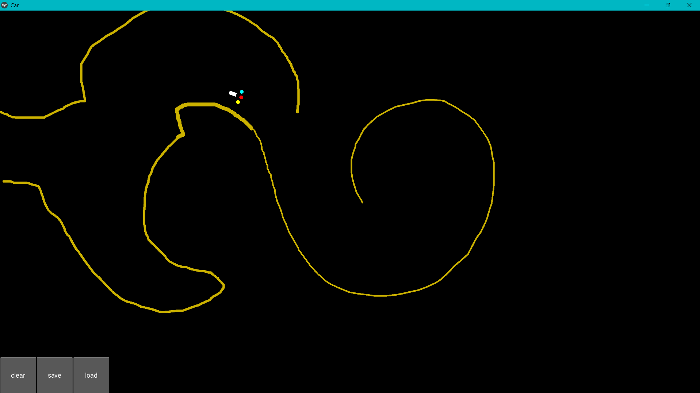

# Self-Driving Car (Deep Q-Learning)

A small car learns to drive back and forth between two corners of the screen while avoiding the "sand" (roads and obstacles) that you draw with the mouse.



*The white car with its 3 sensors (red = front, cyan and yellow = sides), driving around the yellow sand I drew.*

## The idea

The car can't see the whole map. It only has **3 sensors** (front, left and right) that measure how much sand is just ahead of it, plus its angle to the goal. A Deep Q-Network learns from rewards which steering action is best for each situation. You can draw roads while it drives, and it adapts.

## How it works

**State (4 inputs):** orientation toward the goal, plus the 3 sensor signals (sand density around each sensor).

**Actions (3):** go straight, turn 20° left or turn 20° right.

**Rewards:**

| Situation | Reward |
|---|---|
| Driving on sand (also slows the car down) | −1 |
| Hitting the edge of the map | −1 |
| Moving away from the goal | −0.2 |
| Getting closer to the goal | +0.1 |

When the car gets within 100 px of the goal, the goal switches to the opposite corner, so it keeps commuting back and forth.

**Brain (`deep_q_learning.py`, PyTorch):**

- Network: 4 → 30 (ReLU) → 3 Q-values
- Experience replay: memory of 100,000 transitions, learns from random batches of 100
- Action selection: softmax over Q-values with temperature 100 (explores early, exploits later)
- Loss: smooth L1 (Huber), Adam optimizer, γ = 0.9
- Save and load: the trained brain is stored in `last_brain.pth`

## Files

| File | Purpose |
|---|---|
| `map.py` | Kivy app: the map, the car, sensors, rewards and drawing |
| `deep_q_learning.py` | The DQN: network, replay memory, learning step, save and load |
| `car.kv` | Kivy layout for the car and the 3 sensor balls |
| `map.commented.py` | All-in-one version (brain and map in one file) with comments, written while studying the code |
| `last_brain.pth` | A saved trained brain |

## Run it

This project runs in its own conda environment (`selfdrivingcar`) with PyTorch and Kivy.

```bash
# first time only: create the environment
conda create -n selfdrivingcar python
conda activate selfdrivingcar
pip install torch kivy numpy

# run (from inside this folder)
python map.py
```

On Windows PowerShell without conda on the PATH, you can call the env's Python directly:

```powershell
& "$HOME\anaconda3\envs\selfdrivingcar\python.exe" map.py
```

- **Left-click and drag** to draw sand (roads or walls).
- **clear** removes the sand, **save** stores the brain, **load** loads `last_brain.pth`.

## What I learned

- How Deep Q-Learning replaces the Q-table with a neural network so it can handle continuous states.
- Why experience replay matters: learning from random past transitions breaks the correlation between consecutive frames.
- How reward design shapes behavior. Small penalties for drifting away and big penalties for sand produce smooth driving.
- Building an interactive simulation with Kivy.

## Credits

Based on a project from *AI Crash Course* by Hadelin de Ponteves (Packt), studied and extended as part of my [machine-learning](https://github.com/zzzhtetpai-neuroai/machine-learning) learning path.
